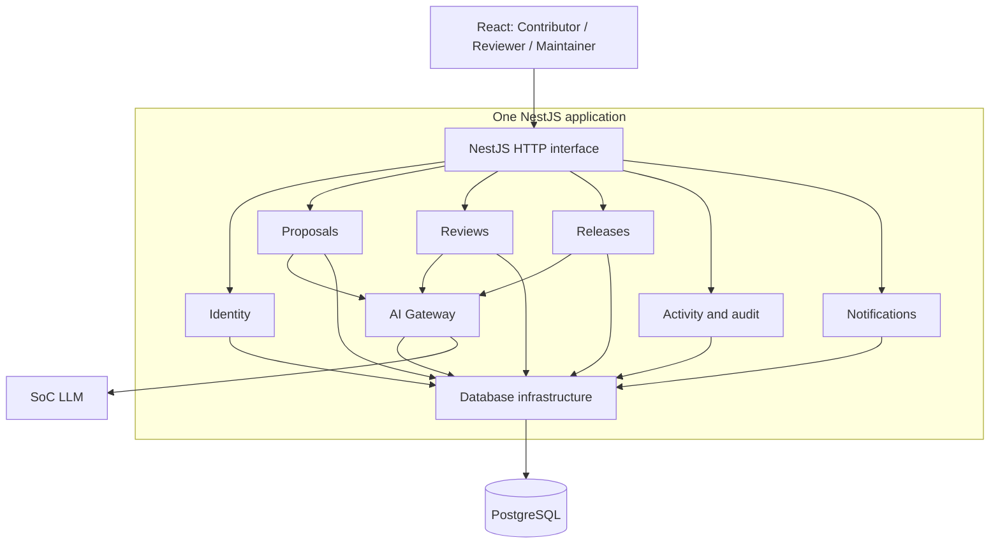

# Architecture

Status: base authentication and the first Reviewer intake increment, 25 October 2026.
The remaining domain behavior is planned under the
[technical specification](../workflow/specs/TECHNICAL-SPEC.md).

## Deployment and responsibilities

One React/Vite browser application calls one NestJS backend under `/api`. In
production a single Docker image serves both from the same origin. PostgreSQL
holds accounts, sessions, login throttles, restricted security events, immutable
submitted revisions, review assignments and separate business activity. Development and production
use separate services, databases and secrets; see [Deployment](Deployment.md).

The diagram is the target design. Health/readiness, authentication, database
connectivity and Reviewer intake are implemented; AI and release operations remain
planned. See [Authentication](Authentication.md).

| Module / directory under server source | Single responsibility |
| --- | --- |
| identity | Establish actor identity: passwords, sessions, account state and role guards |
| proposals | Manage owned working content and immutable submissions, including criteria and optional plain-text evidence |
| reviews | Manage assignment, findings/responses, coverage and human decisions/revocations |
| releases | Assemble candidates, evaluate gates and publish immutable release snapshots |
| activity | Preserve append-only audit evidence and expose authorized timeline/audit projections |
| notifications | Store recipient-scoped in-app notices and acknowledgements |
| ai | Produce bounded advisory suggestions through one server-side gateway |
| database | Supply Prisma connectivity and transaction infrastructure |
| health | Report liveness and database readiness |

`AppModule` composes the modules. `ReviewsModule.register(config)` supplies Reviewer
routes and imports transaction-aware Proposals and Activity services. Contributor
writes, findings, coverage and decisions remain outside this increment. Releases,
Notifications and AI remain empty registrations.
`DatabaseModule.register(config)` owns connectivity configuration and
exports `DatabaseService` for the existing health controller without global state. `IdentityModule.register(config)` imports the same configured
database module and registers the default-protected authentication/CSRF/role guard.

Reviewer services carry the authenticated account/version into a database
transaction and lock the account before proposal roots. Full-content reads check
current assignment before loading relations. Claim/drop and account-disable
release update lifecycle, historical assignments and required activity atomically.
Database constraints enforce one ACTIVE assignment, same-proposal/current-revision
pointers and deferred active-pointer consistency. Submitted content and business
events reject updates/deletes; closed assignment provenance is retained. Business
activity is separate from operational security pruning. Fixture creation is a
development/test CLI operation, not a public API.
Reviewer controller validation failures also create restricted rejection events
after session/role/CSRF enforcement. These events use fixed operation/target
labels and exclude request bodies, query values and shared business activity.

## Implementation seams

Within a business module, controllers translate validated requests, application
use cases authorize and coordinate transactions, domain rules determine valid
transitions, and repositories perform scoped version-checked persistence. Add
these files when a use case needs them, rather than creating empty class layers.
Keep a small module interface; callers must not reach into another module's tables
or private repositories. Avoid generic repositories and a catch-all utility module.

Identity establishes the actor. Each business use case must still check ownership,
assignment, lifecycle, revision and expected version. Proposal lifecycle rules
belong with Proposals; approval rules belong with Reviews; release readiness belongs
with Releases. Reuse those rules through narrow interfaces rather than copying them.

Cross-module commands have one coordinator and one transaction:

| Command | Coordinator | Atomic participants |
| --- | --- | --- |
| Claim/drop | Reviews | Root/version, assignment history/current pointer and business activity |
| Disable reviewer | Account administration | Account/version, unfinished assignment releases, root transitions, security event and business activity |
| Submit revision | Proposals | Revision/state, retained reviewer's new round, activity and notice |
| Revoke approval | Reviews | Approval invalidation, candidate protection, activity and Maintainer notice |
| Publish release | Releases | Fresh gates/approvals, member states, immutable snapshot and activity |

Participating module operations must accept the same transaction context, rather
than independently committing. Publication and revocation serialize on shared
candidate/approval records. Required activity and notices commit with the command;
in-process events after commit are insufficient for those guarantees. These
release and submission interfaces remain to be implemented against
[integration contracts](../workflow/specs/INTEGRATION-SPEC.md).

## Client, contracts and AI

As features are implemented, use `client/src/features/{contributor,reviewer,maintainer}`
for role UI areas and `client/src/shared` for reusable presentation and HTTP handling.
The client has guarded role landing pages and Reviewer intake under
`features/reviewer`. The shared authorization generation discards pending session
and content responses after observed access loss, account change or navigation;
the server remains authoritative for every request. Other role workflows remain pending.
`shared/src/contracts` contains browser-safe Zod wire schemas, re-exported through
`shared/src/index.ts`. Database types, authorization policies, prompts and secrets
remain server-only.

Role use cases select authorized AI context; the gateway applies templates,
redaction, budgets, deadlines, transport and strict output validation. Recheck
scope/revision before returning results. AI may write safe audit/usage metadata,
but cannot mutate proposals, coverage, findings, approvals or releases. The manual
workflow remains usable on AI failure. See the
[AI security specification](../workflow/specs/AI-SECURITY-SPEC.md).
