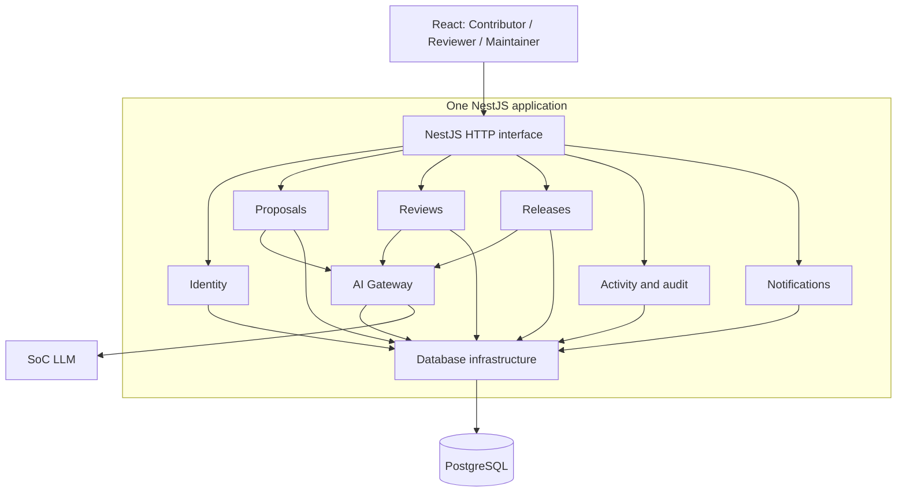

# Architecture

Status: module registration scaffold, 25 October 2026. Product behavior remains
planned under the [technical specification](../workflow/specs/TECHNICAL-SPEC.md).

## Deployment and responsibilities

One React/Vite browser application calls one NestJS backend under `/api`. In
production a single Docker image serves both from the same origin. PostgreSQL
holds business records and, once implemented, sessions. Development and production
use separate services, databases and secrets; see [Deployment](Deployment.md).

The diagram is the target design. Currently only health/readiness, database
connectivity and module registration are implemented.

| Module / directory under server source | Single responsibility |
| --- | --- |
| identity | Establish actor identity: passwords, sessions, account state and role guards |
| proposals | Manage owned working content and immutable submissions, including criteria and optional plain-text evidence |
| reviews | Manage assignment, findings/responses, coverage and human decisions/revocations |
| releases | Assemble candidates, evaluate gates and publish immutable release snapshots |
| activity | Preserve append-only audit evidence and expose authorized timeline/audit projections |
| notifications | Store recipient-scoped in-app notices and acknowledgements |
| ai | Produce bounded advisory suggestions through one server-side gateway |
| database | Supply Prisma connectivity and transaction infrastructure |
| health | Report liveness and database readiness |

`AppModule` composes the modules. Business modules are intentionally empty NestJS
registrations: no placeholder routes, provider calls, domain schema or permissions
are implied. `DatabaseModule.register(config)` owns connectivity configuration and
exports `DatabaseService` for the existing health controller without global state.

## Implementation seams

Within a business module, controllers translate validated requests, application
use cases authorize and coordinate transactions, domain rules determine valid
transitions, and repositories perform scoped version-checked persistence. Add
these files when a use case needs them, rather than creating empty class layers.
Keep a small module interface; callers must not reach into another module's tables
or private repositories. Avoid generic repositories and a catch-all utility module.

Identity establishes the actor. Each business use case must still check ownership,
assignment, lifecycle, revision and expected version. Proposal lifecycle rules
belong with Proposals; approval rules belong with Reviews; release readiness belongs
with Releases. Reuse those rules through narrow interfaces rather than copying them.

Cross-module commands have one coordinator and one transaction:

| Command | Coordinator | Atomic participants |
| --- | --- | --- |
| Submit revision | Proposals | Revision/state, retained reviewer's new round, activity and notice |
| Revoke approval | Reviews | Approval invalidation, candidate protection, activity and Maintainer notice |
| Publish release | Releases | Fresh gates/approvals, member states, immutable snapshot and activity |

Participating module operations must accept the same transaction context, rather
than independently committing. Publication and revocation serialize on shared
candidate/approval records. Required activity and notices commit with the command;
in-process events after commit are insufficient for those guarantees. These
interfaces and domain models remain to be implemented against
[integration contracts](../workflow/specs/INTEGRATION-SPEC.md).

## Client, contracts and AI

`client/src/features/{contributor,reviewer,maintainer}` reserves role UI areas;
`client/src/shared` reserves reusable presentation and HTTP handling. No protected
role screens are registered until authentication/authorization exists.
`shared/src/contracts` contains browser-safe Zod wire schemas, re-exported through
`shared/src/index.ts`. Database types, authorization policies, prompts and secrets
remain server-only.

Role use cases select authorized AI context; the gateway applies templates,
redaction, budgets, deadlines, transport and strict output validation. Recheck
scope/revision before returning results. AI may write safe audit/usage metadata,
but cannot mutate proposals, coverage, findings, approvals or releases. The manual
workflow remains usable on AI failure. See the
[AI security specification](../workflow/specs/AI-SECURITY-SPEC.md).
